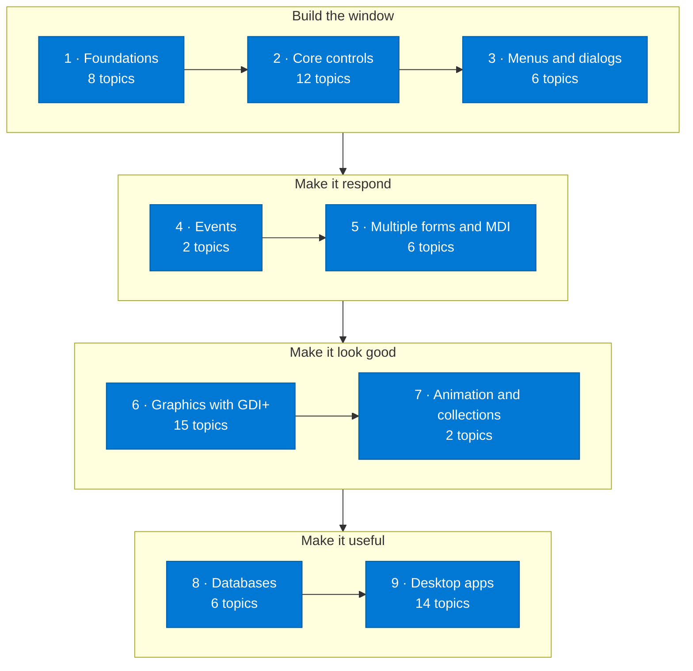
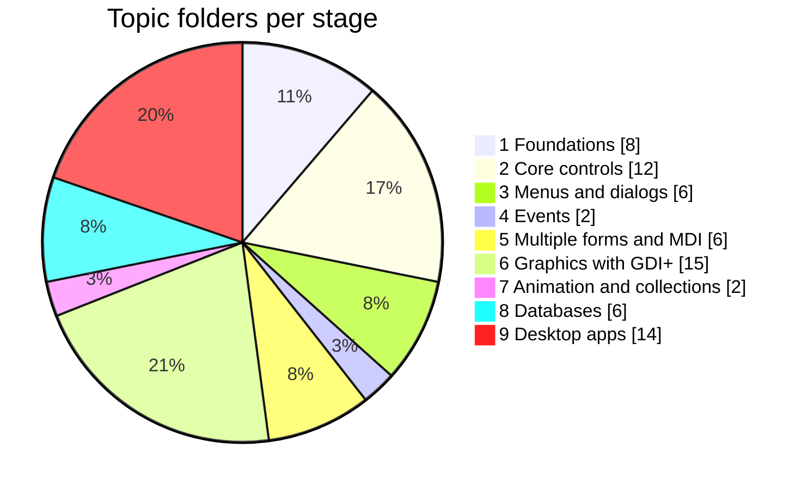
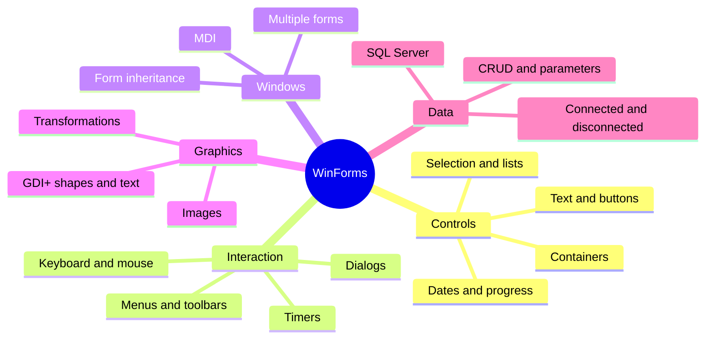

<p align="center">
  
</p>

<p align="center"><b>English</b> &nbsp;·&nbsp; <a href="README.sr.md">Srpski</a></p>

<p align="center">
  <a href="#pick-your-route">Pick your route</a> &nbsp;·&nbsp;
  <a href="#the-path-at-a-glance">The path</a> &nbsp;·&nbsp;
  <a href="#stage-by-stage">Stage by stage</a> &nbsp;·&nbsp;
  <a href="#desktop-apps">Desktop apps</a> &nbsp;·&nbsp;
  <a href="#getting-started">Getting started</a>
</p>

<p align="center">
  
  
  
  
  
  
  <a href="LICENSE"></a>
</p>

This repository is my complete Windows Forms learning path in one place: every control, event and technique I worked through, with the exercises and finished desktop applications I built along the way. It starts at an empty form and ends at GDI+ graphics, MDI applications and SQL Server access.

The content of the files is in **Serbian**. Folder names are in **English**, so the structure is easy to follow whether you read one language or the other.

It is a companion to my [C# Learning Path](https://github.com/MIhajloS07/csharp-learning-resources), which covers the language itself. Windows Forms builds on it, so if classes, inheritance or generics are still unfamiliar, start there.

<table align="center">
  <tr>
    <td align="center" width="25%"><h2>71</h2>topic folders</td>
    <td align="center" width="25%"><h2>9</h2>learning stages</td>
    <td align="center" width="25%"><h2>14</h2>complete desktop apps</td>
    <td align="center" width="25%"><h2>SR + EN</h2>languages</td>
  </tr>
</table>

## Pick your route

The folders are not numbered, so the stages below give them an order. Where you start depends on where you are.

| If you are... | Start here |
| --- | --- |
| **New to Windows Forms** | Go through stages 1, 2 and 3 in order. Each control has its own small folder, so you can stop after any of them and build something. |
| **Comfortable with C# but new to desktop UI** | Begin with [`Winform basics`](Winform%20basics), then jump to events ([`Mouse Events c#`](Mouse%20Events%20c%23), [`Keyboard events c#`](Keyboard%20events%20c%23)) and [`Communication between forms`](Communication%20between%20forms). |
| **Already building WinForms apps** | Use it as a reference. [`Transformations of a graphic object`](Transformations%20of%20a%20graphic%20object), [`MDI templates`](MDI%20templates), [`Threads and animations`](Threads%20and%20animations) and [`Example of a connectionless approach to Db`](Example%20of%20a%20connectionless%20approach%20to%20Db) are good places to refresh a detail. |

> Tip: on the repository page press `t` to open GitHub's file finder and jump straight to a control by name.

## The path at a glance



How the 71 topics are distributed:



And the concepts the path covers:



## Stage by stage

Every stage is collapsed to keep the page short. Open the ones you need.

<details>
<summary><b>1. Foundations</b> &nbsp;·&nbsp; 8 topics</summary>

<br>

Your first forms, the basic controls and how to create and cast controls in code.

| Folder | Topic |
| --- | --- |
| [`Winform basics`](Winform%20basics) | Form anatomy and the first project |
| [`Work with labels`](Work%20with%20labels) | Displaying and updating text with Label |
| [`Work with buttons`](Work%20with%20buttons) | Button clicks and button properties |
| [`Work with TextBox`](Work%20with%20TextBox) | Reading and validating user input |
| [`Control for text input`](Control%20for%20text%20input) | Text-input controls compared |
| [`Control casting`](Control%20casting) | Casting sender to the right control type |
| [`Control casting (objects)`](Control%20casting%20%28objects%29) | Casting controls as objects |
| [`Dynamic creating controls`](Dynamic%20creating%20controls) | Creating controls at run time |

</details>

<details>
<summary><b>2. Core controls</b> &nbsp;·&nbsp; 12 topics</summary>

<br>

Selection, list, date, container and progress controls, one folder per control.

| Folder | Topic |
| --- | --- |
| [`CheckBox control`](CheckBox%20control) | CheckBox and its states |
| [`CheckListBox control`](CheckListBox%20control) | A list of checkable items |
| [`RadioButton control`](RadioButton%20control) | Mutually exclusive choices |
| [`ComboBox control`](ComboBox%20control) | Drop-down selection |
| [`ListBox control`](ListBox%20control) | Working with item lists |
| [`MaskedTextBox control`](MaskedTextBox%20control) | Input with a format mask |
| [`DateTimePicker control`](DateTimePicker%20control) | Picking dates and times |
| [`MonthCalendar control`](MonthCalendar%20control) | The month calendar control |
| [`GroupBox control`](GroupBox%20control) | Grouping related controls |
| [`Panel control`](Panel%20control) | Panels as containers |
| [`ProgressBar control`](ProgressBar%20control) | Showing progress |
| [`Timer control`](Timer%20control) | Running code at intervals |

</details>

<details>
<summary><b>3. Menus and dialogs</b> &nbsp;·&nbsp; 6 topics</summary>

<br>

Menu bars, toolbars, context menus and the standard dialogs.

| Folder | Topic |
| --- | --- |
| [`menuStrip control`](menuStrip%20control) | Main menu bar |
| [`toolStrip control`](toolStrip%20control) | Toolbars |
| [`ContextMenuStrip control`](ContextMenuStrip%20control) | Right-click menus |
| [`ColorDialog and FontDialog control`](ColorDialog%20and%20FontDialog%20control) | Colour and font pickers |
| [`Dialog for work with files`](Dialog%20for%20work%20with%20files) | Open and Save file dialogs |
| [`Font class`](Font%20class) | The Font class |

</details>

<details>
<summary><b>4. Events</b> &nbsp;·&nbsp; 2 topics</summary>

<br>

Reacting to the keyboard and the mouse.

| Folder | Topic |
| --- | --- |
| [`Keyboard events c#`](Keyboard%20events%20c%23) | KeyDown, KeyUp, KeyPress |
| [`Mouse Events c#`](Mouse%20Events%20c%23) | Clicks, movement and wheel |

</details>

<details>
<summary><b>5. Multiple forms and MDI</b> &nbsp;·&nbsp; 6 topics</summary>

<br>

Applications with several windows, passing data between them, MDI and form inheritance.

| Folder | Topic |
| --- | --- |
| [`Multiple forms`](Multiple%20forms) | Opening and managing several forms |
| [`Communication between forms`](Communication%20between%20forms) | Passing data from one form to another |
| [`MDI applications`](MDI%20applications) | Parent and child windows |
| [`MDI templates`](MDI%20templates) | Reusable MDI structure |
| [`Inheritance Winforms`](Inheritance%20Winforms) | Inheriting from your own forms |
| [`OOPWinforms exercise`](OOPWinforms%20exercise) | An OOP exercise with Windows Forms |

</details>

<details>
<summary><b>6. Graphics with GDI+</b> &nbsp;·&nbsp; 15 topics</summary>

<br>

Drawing on a form: coordinates, shapes, text, transformations and images, ending in small drawings.

| Folder | Topic |
| --- | --- |
| [`Introduction to drawing`](Introduction%20to%20drawing) | Graphics object and the Paint event |
| [`SystemDrawing structure`](SystemDrawing%20structure) | The System.Drawing types |
| [`Units of measurement for drawing`](Units%20of%20measurement%20for%20drawing) | Pixels, points and other units |
| [`Drawing lines`](Drawing%20lines) | Lines and pens |
| [`Drawing rectangle`](Drawing%20rectangle) | Rectangles |
| [`Drawing ellipse and circle`](Drawing%20ellipse%20and%20circle) | Ellipses and circles |
| [`Drawing arcs and circular segments`](Drawing%20arcs%20and%20circular%20segments) | Arcs, pies and segments |
| [`Drawing curved lines`](Drawing%20curved%20lines) | Curves |
| [`Draw strings`](Draw%20strings) | Drawing text |
| [`Transformations of a graphic object`](Transformations%20of%20a%20graphic%20object) | Translate, rotate and scale |
| [`Class for work with images`](Class%20for%20work%20with%20images) | A helper class for images |
| [`Picture border`](Picture%20border) | Adding a border to a picture |
| [`Draw heart`](Draw%20heart) | A heart drawn with GDI+ |
| [`Draw William - purple guy`](Draw%20William%20-%20purple%20guy) | A character drawn with GDI+ shapes |
| [`Stop sign - GDI+`](Stop%20sign%20-%20GDI%2B) | A stop sign drawn with GDI+ |

</details>

<details>
<summary><b>7. Animation and collections</b> &nbsp;·&nbsp; 2 topics</summary>

<br>

Moving things on screen with timers and threads, plus a generic Queue.

| Folder | Topic |
| --- | --- |
| [`Threads and animations`](Threads%20and%20animations) | Threads and animation |
| [`Queue generic collection`](Queue%20generic%20collection) | The generic Queue collection |

</details>

<details>
<summary><b>8. Databases</b> &nbsp;·&nbsp; 6 topics</summary>

<br>

Working with SQL Server from Windows Forms: connected and disconnected access, and CRUD on the Northwind database.

| Folder | Topic |
| --- | --- |
| [`Example of a connection approach to MSSQL`](Example%20of%20a%20connection%20approach%20to%20MSSQL) | Connected access to SQL Server |
| [`Example of a connectionless approach to Db`](Example%20of%20a%20connectionless%20approach%20to%20Db) | Disconnected access |
| [`Create data in NorthWind Db`](Create%20data%20in%20NorthWind%20Db) | Inserting rows |
| [`Read data from Northwind Db`](Read%20data%20from%20Northwind%20Db) | Reading rows |
| [`Update data in NorthWind Db`](Update%20data%20in%20NorthWind%20Db) | Updating rows |
| [`Parameterized queries exercise`](Parameterized%20queries%20exercise) | Parameterized SQL queries |

</details>

## Desktop apps

The last stage (14 projects) puts everything together. These are complete applications, and the quickest way to see how controls, events, graphics and data fit into a program that actually runs.

| Folder | What it is |
| --- | --- |
| [`Alarm clock - desktop app`](Alarm%20clock%20-%20desktop%20app) | An alarm clock |
| [`Bank account - desktop app`](Bank%20account%20-%20desktop%20app) | A bank account app |
| [`Click to button game - desktop`](Click%20to%20button%20game%20-%20desktop) | A button-clicking game |
| [`DarkLightThemeWithButton c# desktop app`](DarkLightThemeWithButton%20c%23%20desktop%20app) | Dark / light theme switch |
| [`Guessing the imagined number GUI - desktop app`](Guessing%20the%20imagined%20number%20GUI%20-%20desktop%20app) | Guess-the-number game |
| [`IncrementAndDecrement desktop app`](IncrementAndDecrement%20desktop%20app) | A counter with + and − |
| [`Jukebox - desktop app`](Jukebox%20-%20desktop%20app) | A jukebox |
| [`Moving a player - desktop app`](Moving%20a%20player%20-%20desktop%20app) | Moving a player with the keyboard |
| [`Product Prices (MSSQL) desktop app`](Product%20Prices%20%28MSSQL%29%20desktop%20app) | Product prices from SQL Server |
| [`Programming OOP mini exam Winforms`](Programming%20OOP%20mini%20exam%20Winforms) | An OOP mini exam |
| [`Solving a system of linear equations - desktop app`](Solving%20a%20system%20of%20linear%20equations%20-%20desktop%20app) | A linear-equation solver |
| [`Typing speed test - desktop app`](Typing%20speed%20test%20-%20desktop%20app) | A typing speed test |
| [`VOB to MPEG convertor - desktop app`](VOB%20to%20MPEG%20convertor%20-%20desktop%20app) | A VOB to MPEG converter |
| [`mini-product-app`](mini-product-app) | A small product-management app |

## Getting started

Windows Forms runs on Windows. You need [Visual Studio](https://visualstudio.microsoft.com/) with the **.NET desktop development** workload.

```bash
git clone https://github.com/MIhajloS07/winforms-learning-resources.git
cd winforms-learning-resources
```

Open the project file (`.sln` or `.csproj`) inside a topic folder in Visual Studio and press `F5`.

The database topics ([`Example of a connection approach to MSSQL`](Example%20of%20a%20connection%20approach%20to%20MSSQL), the Northwind folders and [`Product Prices (MSSQL) desktop app`](Product%20Prices%20%28MSSQL%29%20desktop%20app)) need access to a SQL Server instance. You will have to adjust the connection string to match yours.

A suggestion for studying with it: read the code first, predict what the window does, run it, then change a property or an event handler and run it again. That is how most of it was written in the first place.

## Where to go next

This repository stops at classic Windows Forms and ADO.NET. Natural next steps, none of which are covered here:

- Entity Framework Core instead of hand-written ADO.NET
- Data binding and the MVP / MVVM patterns
- WPF or .NET MAUI for newer desktop UIs
- Unit testing with xUnit or NUnit

## Contributing

Found a mistake, or have a cleaner solution to an exercise? Open an issue or a pull request. Typo fixes are welcome too.

## License and author

Released under the [MIT License](LICENSE). Written by [Mihajlo Stoiljković](https://github.com/MIhajloS07).

<p align="center">
  
</p>
