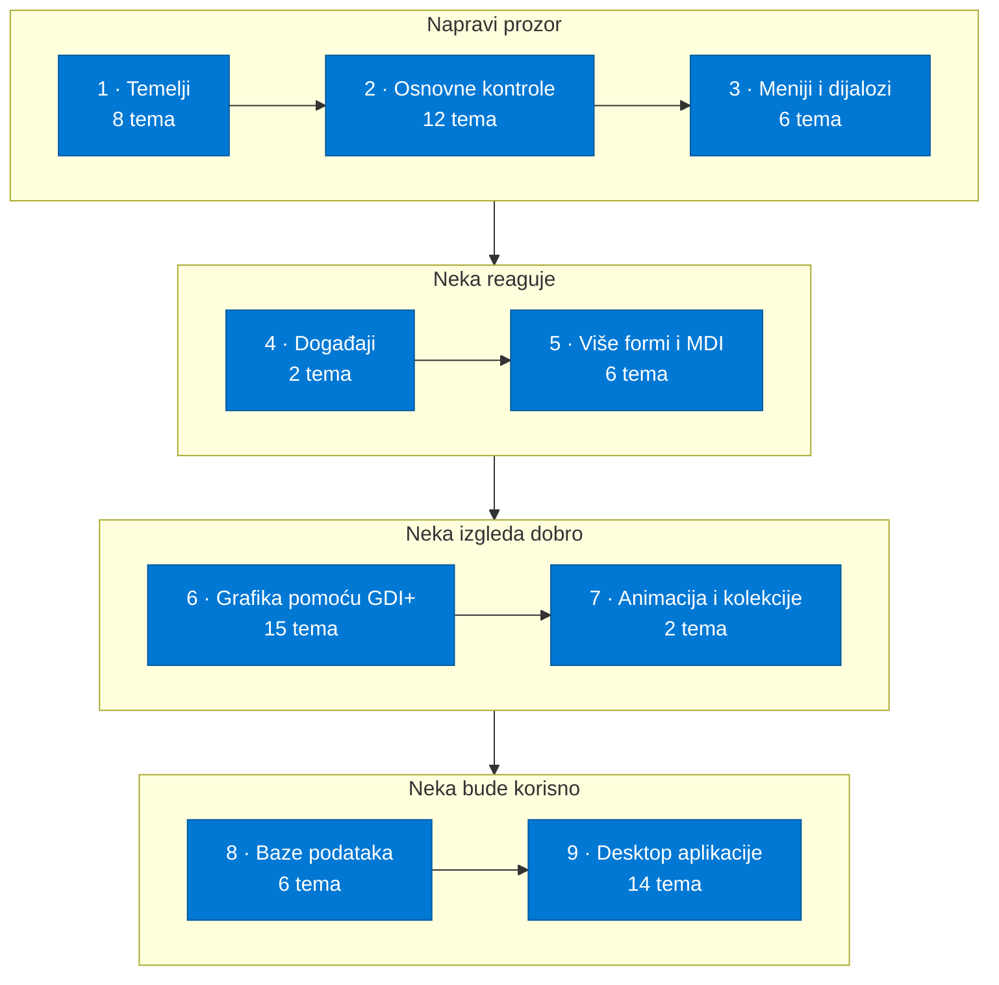
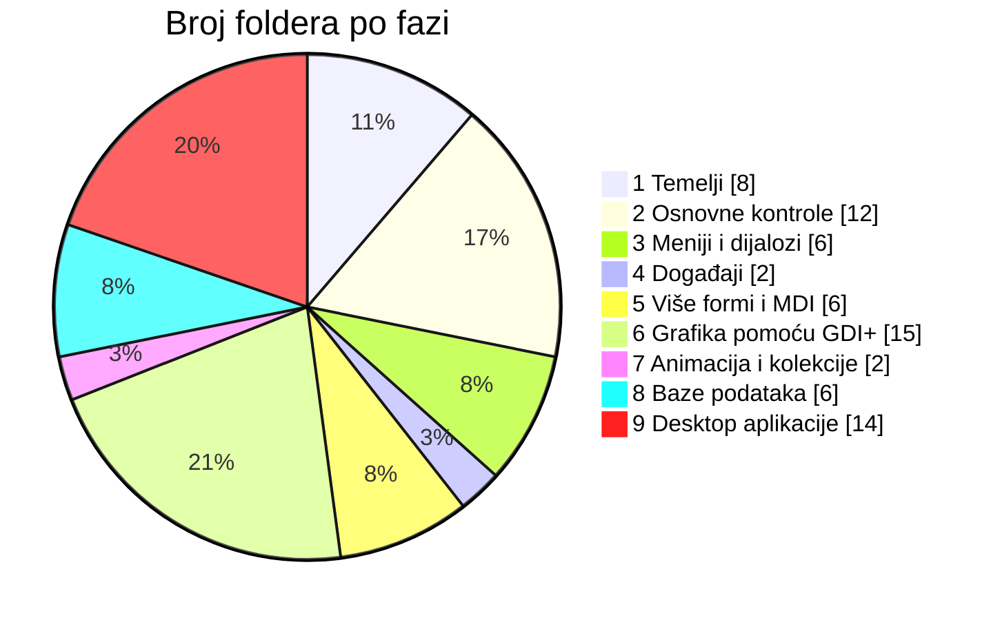
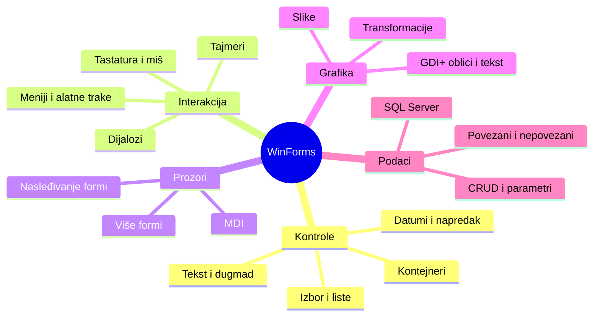

<p align="center">
  
</p>

<p align="center"><a href="README.md">English</a> &nbsp;·&nbsp; <b>Srpski</b></p>

<p align="center">
  <a href="#izaberi-svoj-put">Izaberi svoj put</a> &nbsp;·&nbsp;
  <a href="#pregled-puta">Pregled puta</a> &nbsp;·&nbsp;
  <a href="#faza-po-faza">Faza po faza</a> &nbsp;·&nbsp;
  <a href="#desktop-aplikacije">Desktop aplikacije</a> &nbsp;·&nbsp;
  <a href="#pokretanje">Pokretanje</a>
</p>

<p align="center">
  
  
  
  
  
  
  <a href="LICENSE"></a>
</p>

Ovaj repozitorijum je ceo moj put kroz Windows Forms na jednom mestu: sve kontrole, događaji i tehnike koje sam prošao, sa vežbama i gotovim desktop aplikacijama koje sam usput napravio. Počinje od prazne forme, a završava se GDI+ grafikom, MDI aplikacijama i radom sa SQL Serverom.

Sadržaj fajlova je na **srpskom**. Imena foldera su na **engleskom**, tako da se struktura lako prati bez obzira na to koji jezik govoriš.

Ovo je pratilac mog [C# Learning Path](https://github.com/MIhajloS07/csharp-learning-resources) repozitorijuma koji pokriva sam jezik. Windows Forms se nadovezuje na njega, pa ako ti klase, nasleđivanje ili generici još nisu jasni, kreni odatle.

<table align="center">
  <tr>
    <td align="center" width="25%"><h2>71</h2>foldera sa temama</td>
    <td align="center" width="25%"><h2>9</h2>faze učenja</td>
    <td align="center" width="25%"><h2>14</h2>kompletnih desktop aplikacija</td>
    <td align="center" width="25%"><h2>SR + EN</h2>jezika</td>
  </tr>
</table>

## Izaberi svoj put

Folderi nisu numerisani, pa im faze ispod daju redosled. Odakle ćeš krenuti zavisi od toga gde si sada.

| Ako si... | Kreni odavde |
| --- | --- |
| **Početnik u Windows Forms-u** | Prođi faze 1, 2 i 3 redom. Svaka kontrola ima svoj mali folder, pa možeš da staneš posle bilo koje i napraviš nešto. |
| **Znaš C#, ali ne i desktop UI** | Počni od [`Winform basics`](Winform%20basics), pa pređi na događaje ([`Mouse Events c#`](Mouse%20Events%20c%23), [`Keyboard events c#`](Keyboard%20events%20c%23)) i [`Communication between forms`](Communication%20between%20forms). |
| **Već praviš WinForms aplikacije** | Koristi ga kao podsetnik. [`Transformations of a graphic object`](Transformations%20of%20a%20graphic%20object), [`MDI templates`](MDI%20templates), [`Threads and animations`](Threads%20and%20animations) i [`Example of a connectionless approach to Db`](Example%20of%20a%20connectionless%20approach%20to%20Db) su dobra mesta da osvežiš neki detalj. |

> Savet: na stranici repozitorijuma pritisni `t` da otvoriš GitHub-ov pretraživač fajlova i odmah skočiš na kontrolu po imenu.

## Pregled puta



Raspodela 71 tema po fazama:



I koncepti koje put pokriva:



## Faza po faza

Svaka faza je zatvorena da bi stranica ostala kratka. Otvori one koje ti trebaju.

<details>
<summary><b>1. Temelji</b> &nbsp;·&nbsp; 8 tema</summary>

<br>

Prve forme, osnovne kontrole i kako se kontrole prave i kastuju iz koda.

| Folder | Tema |
| --- | --- |
| [`Winform basics`](Winform%20basics) | Anatomija forme i prvi projekat |
| [`Work with labels`](Work%20with%20labels) | Prikaz i izmena teksta pomoću Label-a |
| [`Work with buttons`](Work%20with%20buttons) | Klikovi i svojstva dugmeta |
| [`Work with TextBox`](Work%20with%20TextBox) | Čitanje i provera korisničkog unosa |
| [`Control for text input`](Control%20for%20text%20input) | Poređenje kontrola za unos teksta |
| [`Control casting`](Control%20casting) | Kastovanje sender-a u pravi tip kontrole |
| [`Control casting (objects)`](Control%20casting%20%28objects%29) | Kastovanje kontrola kao objekata |
| [`Dynamic creating controls`](Dynamic%20creating%20controls) | Pravljenje kontrola u toku izvršavanja |

</details>

<details>
<summary><b>2. Osnovne kontrole</b> &nbsp;·&nbsp; 12 tema</summary>

<br>

Kontrole za izbor, liste, datume, kontejneri i napredak, po jedan folder za svaku kontrolu.

| Folder | Tema |
| --- | --- |
| [`CheckBox control`](CheckBox%20control) | CheckBox i njegova stanja |
| [`CheckListBox control`](CheckListBox%20control) | Lista stavki koje se čekiraju |
| [`RadioButton control`](RadioButton%20control) | Međusobno isključivi izbori |
| [`ComboBox control`](ComboBox%20control) | Padajuća lista za izbor |
| [`ListBox control`](ListBox%20control) | Rad sa listama stavki |
| [`MaskedTextBox control`](MaskedTextBox%20control) | Unos sa maskom formata |
| [`DateTimePicker control`](DateTimePicker%20control) | Biranje datuma i vremena |
| [`MonthCalendar control`](MonthCalendar%20control) | Kontrola mesečnog kalendara |
| [`GroupBox control`](GroupBox%20control) | Grupisanje povezanih kontrola |
| [`Panel control`](Panel%20control) | Paneli kao kontejneri |
| [`ProgressBar control`](ProgressBar%20control) | Prikaz napretka |
| [`Timer control`](Timer%20control) | Izvršavanje koda u intervalima |

</details>

<details>
<summary><b>3. Meniji i dijalozi</b> &nbsp;·&nbsp; 6 tema</summary>

<br>

Meni trake, alatne trake, kontekstni meniji i standardni dijalozi.

| Folder | Tema |
| --- | --- |
| [`menuStrip control`](menuStrip%20control) | Glavni meni |
| [`toolStrip control`](toolStrip%20control) | Alatne trake |
| [`ContextMenuStrip control`](ContextMenuStrip%20control) | Meniji na desni klik |
| [`ColorDialog and FontDialog control`](ColorDialog%20and%20FontDialog%20control) | Biranje boje i fonta |
| [`Dialog for work with files`](Dialog%20for%20work%20with%20files) | Dijalozi za otvaranje i snimanje fajlova |
| [`Font class`](Font%20class) | Klasa Font |

</details>

<details>
<summary><b>4. Događaji</b> &nbsp;·&nbsp; 2 tema</summary>

<br>

Reagovanje na tastaturu i miša.

| Folder | Tema |
| --- | --- |
| [`Keyboard events c#`](Keyboard%20events%20c%23) | KeyDown, KeyUp, KeyPress |
| [`Mouse Events c#`](Mouse%20Events%20c%23) | Klikovi, kretanje i točkić |

</details>

<details>
<summary><b>5. Više formi i MDI</b> &nbsp;·&nbsp; 6 tema</summary>

<br>

Aplikacije sa više prozora, prosleđivanje podataka među njima, MDI i nasleđivanje formi.

| Folder | Tema |
| --- | --- |
| [`Multiple forms`](Multiple%20forms) | Otvaranje i upravljanje sa više formi |
| [`Communication between forms`](Communication%20between%20forms) | Prosleđivanje podataka između formi |
| [`MDI applications`](MDI%20applications) | Roditeljski i dečji prozori |
| [`MDI templates`](MDI%20templates) | Višekratno upotrebljiva MDI struktura |
| [`Inheritance Winforms`](Inheritance%20Winforms) | Nasleđivanje sopstvenih formi |
| [`OOPWinforms exercise`](OOPWinforms%20exercise) | OOP vežba u Windows Forms-u |

</details>

<details>
<summary><b>6. Grafika pomoću GDI+</b> &nbsp;·&nbsp; 15 tema</summary>

<br>

Crtanje na formi: koordinate, oblici, tekst, transformacije i slike, uz nekoliko crteža na kraju.

| Folder | Tema |
| --- | --- |
| [`Introduction to drawing`](Introduction%20to%20drawing) | Graphics objekat i Paint događaj |
| [`SystemDrawing structure`](SystemDrawing%20structure) | Tipovi iz System.Drawing |
| [`Units of measurement for drawing`](Units%20of%20measurement%20for%20drawing) | Pikseli, tačke i druge jedinice |
| [`Drawing lines`](Drawing%20lines) | Linije i olovke (Pen) |
| [`Drawing rectangle`](Drawing%20rectangle) | Pravougaonici |
| [`Drawing ellipse and circle`](Drawing%20ellipse%20and%20circle) | Elipse i krugovi |
| [`Drawing arcs and circular segments`](Drawing%20arcs%20and%20circular%20segments) | Lukovi i isečci |
| [`Drawing curved lines`](Drawing%20curved%20lines) | Krive linije |
| [`Draw strings`](Draw%20strings) | Crtanje teksta |
| [`Transformations of a graphic object`](Transformations%20of%20a%20graphic%20object) | Pomeranje, rotacija i skaliranje |
| [`Class for work with images`](Class%20for%20work%20with%20images) | Pomoćna klasa za slike |
| [`Picture border`](Picture%20border) | Okvir oko slike |
| [`Draw heart`](Draw%20heart) | Srce nacrtano pomoću GDI+ |
| [`Draw William - purple guy`](Draw%20William%20-%20purple%20guy) | Lik nacrtan GDI+ oblicima |
| [`Stop sign - GDI+`](Stop%20sign%20-%20GDI%2B) | Znak stop nacrtan pomoću GDI+ |

</details>

<details>
<summary><b>7. Animacija i kolekcije</b> &nbsp;·&nbsp; 2 tema</summary>

<br>

Pokretanje stvari na ekranu pomoću tajmera i niti, i generički Queue.

| Folder | Tema |
| --- | --- |
| [`Threads and animations`](Threads%20and%20animations) | Niti i animacije |
| [`Queue generic collection`](Queue%20generic%20collection) | Generička kolekcija Queue |

</details>

<details>
<summary><b>8. Baze podataka</b> &nbsp;·&nbsp; 6 tema</summary>

<br>

Rad sa SQL Serverom iz Windows Forms-a: povezani i nepovezani pristup, i CRUD nad Northwind bazom.

| Folder | Tema |
| --- | --- |
| [`Example of a connection approach to MSSQL`](Example%20of%20a%20connection%20approach%20to%20MSSQL) | Povezani pristup SQL Serveru |
| [`Example of a connectionless approach to Db`](Example%20of%20a%20connectionless%20approach%20to%20Db) | Nepovezani pristup bazi |
| [`Create data in NorthWind Db`](Create%20data%20in%20NorthWind%20Db) | Ubacivanje redova |
| [`Read data from Northwind Db`](Read%20data%20from%20Northwind%20Db) | Čitanje redova |
| [`Update data in NorthWind Db`](Update%20data%20in%20NorthWind%20Db) | Izmena redova |
| [`Parameterized queries exercise`](Parameterized%20queries%20exercise) | Parametrizovani SQL upiti |

</details>

## Desktop aplikacije

Poslednja faza (14 projekata) spaja sve prethodno. Ovo su kompletne aplikacije i najbrži način da vidiš kako se kontrole, događaji, grafika i podaci uklapaju u program koji zaista radi.

| Folder | Šta je |
| --- | --- |
| [`Alarm clock - desktop app`](Alarm%20clock%20-%20desktop%20app) | Budilnik |
| [`Bank account - desktop app`](Bank%20account%20-%20desktop%20app) | Aplikacija za bankovni račun |
| [`Click to button game - desktop`](Click%20to%20button%20game%20-%20desktop) | Igra klikanja na dugme |
| [`DarkLightThemeWithButton c# desktop app`](DarkLightThemeWithButton%20c%23%20desktop%20app) | Prebacivanje tamne i svetle teme |
| [`Guessing the imagined number GUI - desktop app`](Guessing%20the%20imagined%20number%20GUI%20-%20desktop%20app) | Igra pogađanja zamišljenog broja |
| [`IncrementAndDecrement desktop app`](IncrementAndDecrement%20desktop%20app) | Brojač sa + i − |
| [`Jukebox - desktop app`](Jukebox%20-%20desktop%20app) | Džuboks |
| [`Moving a player - desktop app`](Moving%20a%20player%20-%20desktop%20app) | Pomeranje igrača tastaturom |
| [`Product Prices (MSSQL) desktop app`](Product%20Prices%20%28MSSQL%29%20desktop%20app) | Cene proizvoda iz SQL Servera |
| [`Programming OOP mini exam Winforms`](Programming%20OOP%20mini%20exam%20Winforms) | Mini ispit iz OOP-a |
| [`Solving a system of linear equations - desktop app`](Solving%20a%20system%20of%20linear%20equations%20-%20desktop%20app) | Rešavač sistema linearnih jednačina |
| [`Typing speed test - desktop app`](Typing%20speed%20test%20-%20desktop%20app) | Test brzine kucanja |
| [`VOB to MPEG convertor - desktop app`](VOB%20to%20MPEG%20convertor%20-%20desktop%20app) | Konvertor VOB u MPEG |
| [`mini-product-app`](mini-product-app) | Mala aplikacija za rad sa proizvodima |

## Pokretanje

Windows Forms radi na Windows-u. Potreban ti je [Visual Studio](https://visualstudio.microsoft.com/) sa **.NET desktop development** paketom.

```bash
git clone https://github.com/MIhajloS07/winforms-learning-resources.git
cd winforms-learning-resources
```

U Visual Studio-u otvori projektni fajl (`.sln` ili `.csproj`) iz foldera neke teme i pritisni `F5`.

Teme o bazama ([`Example of a connection approach to MSSQL`](Example%20of%20a%20connection%20approach%20to%20MSSQL), Northwind folderi i [`Product Prices (MSSQL) desktop app`](Product%20Prices%20%28MSSQL%29%20desktop%20app)) traže pristup SQL Server instanci. Connection string ćeš morati da prilagodiš svojoj.

Predlog kako da učiš iz ovoga: prvo pročitaj kod i pogodi šta prozor radi, pa ga pokreni, zatim promeni neko svojstvo ili obrađivač događaja i pokreni opet. Tako je većina i nastala.

## Dalji koraci

Ovaj repozitorijum staje na klasičnom Windows Forms-u i ADO.NET-u. Prirodni sledeći koraci, od kojih nijedan ovde nije pokriven:

- Entity Framework Core umesto ručno pisanog ADO.NET-a
- Data binding i MVP / MVVM obrasci
- WPF ili .NET MAUI za novije desktop interfejse
- Unit testiranje pomoću xUnit-a ili NUnit-a

## Doprinos

Našao si grešku ili imaš čistije rešenje nekog zadatka? Otvori issue ili pull request. Ispravke slovnih grešaka su takođe dobrodošle.

## Licenca i autor

Objavljeno pod [MIT licencom](LICENSE). Autor: [Mihajlo Stoiljković](https://github.com/MIhajloS07).

<p align="center">
  
</p>
